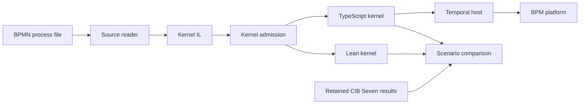

# BPMN on Temporal Workflows

This project builds a BPMN execution engine on Temporal Workflows, with Lean to make process behavior precise. One execution kernel, written in Lean and transcribed to TypeScript, decides what a BPMN process does; Temporal keeps processes running across waits and failures.

The goal is practical BPMN 2.0.2 execution within **CIB Seven's implemented element breadth and feature depth**. [Practical CIB7 Coverage](docs/PRACTICAL-CIB7-COVERAGE-TARGET.md) is the delivery target, covering useful feature depth and whole-process combinations. Full OMG Process Execution Conformance is not promised. A BPM platform adds human work and process operations through the engine's public API.

- 🐳 **Evaluate the release candidate:** [Run the Docker or Rancher Desktop demo](#try-the-release-candidate-with-docker-or-rancher-desktop). No checkout or build needed.
- 🔬 **Understand the approach:** Read [why this project exists](#why-this-project-exists) and [the architecture at a glance](#architecture-at-a-glance).
- 🛠️ **Contribute:** [Prepare a contributor environment](#prepare-a-contributor-environment).

## Try the release candidate with Docker or Rancher Desktop

The [v0.2.0-rc.1 evaluation bundle](https://github.com/mbackschat/bpmn-lean-experiment/releases/download/v0.2.0-rc.1/mue-evaluation-v0.2.0-rc.1.tar.gz) runs the browser app and its engine from published Docker images. It packages release candidate `v0.2.0-rc.1` (commit `16c5b9f6`), built on the engine generation that preceded the current kernel. You need Docker Compose `2.24.4` or later, a browser, `curl`, and `shasum`. No repository checkout, Node, pnpm, Lean, Temporal installation, or image build is needed.

**🐳 1. Start your container engine.** On macOS, use Docker Desktop or [Rancher Desktop](https://docs.rancherdesktop.io/getting-started/installation/). On Linux, use Rancher Desktop or Docker Engine with the Compose plugin. In Rancher Desktop, select **dockerd (moby)** as the container engine so the same Docker commands work. Check that `docker info` succeeds and `docker compose version` shows `2.24.4` or later.

On Windows, the Docker images require Linux-container mode, and the `demo` launcher requires a Unix shell. Native PowerShell and Command Prompt cannot run it as written. Running the commands inside a WSL 2 Linux distribution with [Docker Desktop WSL integration](https://docs.docker.com/desktop/features/wsl/) is a possible route, but this project has not qualified that Windows setup.

**📦 2. Download and start the demo.** Copy these commands into a terminal:

```sh
mkdir -p bpmn-evaluation && cd bpmn-evaluation
curl --fail --location --output demo.tar.gz https://github.com/mbackschat/bpmn-lean-experiment/releases/download/v0.2.0-rc.1/mue-evaluation-v0.2.0-rc.1.tar.gz
tar -xzf demo.tar.gz
./deploy/evaluation/demo prepare
```

The last command downloads the published images, starts the stack, and prepares three interactive processes. You complete their human tasks yourself.

**🌐 3. Try a process.** Open the printed `LIVE_DEMO_READY` address. Choose **Definitions → Explore process showcases**, start a prepared process, then complete its task under **Work**.

The [browser walkthrough](docs/BPM-PLATFORM-BROWSER-WALKTHROUGH.md#zero-build-demo-machine) covers the full journey and evaluation limits. From the same directory, use `./deploy/evaluation/demo stop` when finished and `./deploy/evaluation/demo start` to resume later.

## Why this project exists

Moving BPMN processes from an engine such as CIB Seven to Temporal raises a question: **will the processes still behave as their BPMN models specify?** Parallel work, messages, timers, and cancellation must keep their meaning even when the underlying runtime changes.

- **BPMN 2.0.2** defines what the process elements mean and how they should execute.
- **CIB Seven** provides a mature implementation against which we compare selected behavior, including explicitly scoped compatibility choices.
- **Temporal** provides reliable workflow execution and recovery. The BPMN engine still has to decide how a BPMN process behaves.

The approach separates **process meaning** from **execution infrastructure**. The BPMN rules live in one execution kernel; Temporal hosts it and never decides BPMN behavior. This makes the rules reviewable without having to infer them from retries, queues, or runtime scheduling.

### Why Lean and TypeScript?

**Lean states the rules precisely.** A BPMN engine must handle more than the happy path: parallel work may finish in different orders, and a process may be cancelled while it is waiting. The kernel is first written in Lean, a programming language with a mathematical proof checker, as an executable specification, and each feature states its rules declaratively beside the code that implements them.

**TypeScript runs those rules.** A separately written TypeScript transcription of the Lean kernel decides which process steps run next, what must wait, and how tasks and events change a process. It performs no network or database operations, so it can be tested on its own and then inside a Temporal Workflow. Lean is used during development and verification; you do not need it to run the engine.

**Checks answer different questions.** The Lean kernel checks the execution model; tests check that the TypeScript kernel and the Temporal hosting follow it, and selected scenarios are compared with retained CIB Seven results. Neither proves that the whole engine conforms to BPMN: two implementations agreeing does not establish that their shared interpretation is correct, so every interpretation is also reviewed against the BPMN standard.

<p align="center">
  <a href="docs/assets/project-infographics/why-lean-helps.avif"></a>
</p>

The graphic connects the execution model, the running engine, and their checks. Its source notes are in the [infographics guide](docs/INFOGRAPHICS.md).

### Why Temporal?

Business processes may wait hours or days for people, messages, timers, or external services. Temporal records their execution so they can resume after a worker fails. It also supplies durable timers, messaging, and retried service calls, avoiding the need to build that infrastructure from scratch.

The kernel runs inside a Temporal Workflow. The kernel owns the BPMN decisions; Temporal owns durable coordination and recovery. A retried service call can still repeat an external action, so integrations must handle duplicate requests. The [Temporal research](docs/research/TEMPORAL-EXECUTION-RESEARCH.md#executive-model) explains the tradeoffs.

<details>
<summary>Optional: repository statistics</summary>

#### Repository statistics

These counts describe the scale of the formal model and implementation. Several declarations can support one behavior, so their number does not measure BPMN conformance or independent guarantees.

##### Lean declarations

<!-- publication-statistics:lean-declarations:start -->
| Metric | Count |
|---|---:|
| Public theorem declarations | 24 |
| Supporting lemma declarations | 0 |
| All declaration commands | 726 |
| Proof declarations / all declaration commands | 3.3% |

Supporting lemmas count `private theorem` and every explicit `lemma` command, matching the repository convention. All declaration commands count `theorem`, `lemma`, `def`, `abbrev`, `opaque`, `axiom`, `constant`, `inductive`, `structure`, `class`, and `instance` after masking Lean comments and literals.
<!-- publication-statistics:lean-declarations:end -->

##### Language footprint

<!-- publication-statistics:language-footprint:start -->
| Language | Files | Code | Comments | Blanks |
|---|---:|---:|---:|---:|
| Java | 75 | 12,185 | 581 | 1,384 |
| TypeScript | 1,013 | 169,345 | 6,442 | 12,968 |
| Lean | 42 | 5,771 | 1,251 | 943 |
<!-- publication-statistics:language-footprint:end -->

Maintainers refresh these tables with `./scripts/pnpm.sh run publication-stats:update`. Tokei measures source size and is needed only for this publication step.

</details>

## Architecture at a glance



| Component | What it contributes |
|---|---|
| Source reader | Reads the BPMN file, preserves the exact bytes, and emits the kernel IL; it refuses only what it cannot read faithfully |
| Kernel IL | One flat table of elements (activities, scopes, events, gateways, starts) shaped for the whole target; a field outside the admitted surface is refused with a stable code |
| Lean kernel | The executable specification: admission, a pure step function per input, population mechanisms across instances, and declarative laws per feature |
| TypeScript kernel | A separately written transcription of the Lean kernel, with no Temporal or CIB dependency |
| Temporal host | Drives the kernel from durable starts, commands, message deliveries, timers, and effect results, without defining BPMN behavior |
| BPM platform | Adds process deployment, a task inbox, forms, monitoring, and Action history through the engine's API |

A process definition is immutable kernel IL; each running instance has its own changing state, and every input (start, command, delivery, timer firing, effect result) is applied by the same pure step. The [kernel architecture](docs/kernel/ARCHITECTURE-SPEC.md) explains the design and its guardrails, and the [architecture](docs/ARCHITECTURE.md) maps it to packages and deployments.

<p align="center">
  <a href="docs/assets/project-infographics/correctness-stack.avif"></a>
</p>

This graphic shows how the different checks build confidence together. Its source notes are in the [infographics guide](docs/INFOGRAPHICS.md).

## Key decisions

- **Execute process models through an interpreter.** BPMN files become process data for one shared kernel, rather than separately generated TypeScript workflows.
- **Keep definitions traceable.** Each definition records its original BPMN file and the selected execution rules, called a **semantic profile**. Changing either creates a different definition.
- **Make unsupported behavior visible.** The kernel admits only the surface a profile supports and refuses everything else with a stable code. It does not silently approximate an unsupported BPMN feature or invent an ordering for ambiguous concurrent work.
- **Keep BPMN and CIB compatibility distinct.** BPMN is the standard; comparisons with CIB Seven establish only the explicitly selected compatibility behavior, classified in the [CIB–BPMN relation register](docs/CIB-BPMN-RELATION-REGISTER.md). See the [conformance target](docs/BPMN-CONFORMANCE-TARGET.md) for the full goal.

## Prepare a contributor environment

The full verification environment needs Node `26.10.0`, pnpm `12.18.0`, Git, `curl`, `jq`, `xmllint`, `unzip`, Lean through `elan`, and Java 21:

```sh
nvm install
nvm use
npm install --global --ignore-scripts --no-audit --no-fund pnpm@12.18.0
./scripts/setup-external-sources.sh verify
./scripts/pnpm.sh install --frozen-lockfile
./scripts/doctor.sh verify
./scripts/pnpm.sh run test:pre-push:verify
```

Use [`./scripts/lake.sh`](scripts/lake.sh) for every Lean build. It is the single owner of repository Lean parallelism and prevents concurrent build trees. Setup and clean-machine recovery are in the [contributor setup guide](docs/CONTRIBUTOR-SETUP-GUIDE.md); the local and hosted gates are in the [engineering policy](docs/kernel/ENGINEERING-POLICY.md#verification).

## Repository guide

```text
Kernel/              Lean kernel: IL, state, step, features, admission, population, runner
contracts/           Language-neutral JSON Schemas
docs/                Kernel architecture and semantics, specifications, research, and the plan
model-corpus/        Retained and classified executable whole-model corpus
packages/            Source reader, TypeScript kernel, Temporal host, engine API, and differential comparison
platform/            BPM platform applications, modules, foundations, and UI
profiles/            Reviewed semantic-profile artifacts
runners/             Pinned adapters to external executable oracles
scenarios/           Answer-free BPMN scenarios and separate content-bound evidence
scripts/             Maintained verification and infrastructure guards
showcase/            BPM platform acceptance harnesses
```

| Need | Read |
|---|---|
| Try a process and complete its tasks | [Browser walkthrough](docs/BPM-PLATFORM-BROWSER-WALKTHROUGH.md) |
| Understand the kernel design | [Kernel architecture](docs/kernel/ARCHITECTURE-SPEC.md) |
| Check which coverage rows the kernel implements | [Kernel status map](docs/kernel/KERNEL-STATUS-MAP.md) |
| Understand the approach and component responsibilities | [Project design](docs/PROJECT-DESIGN.md) |
| Understand packages and deployment | [Architecture](docs/ARCHITECTURE.md) |
| Inspect the executable model collection | [Model corpus](model-corpus/README.md) |
| Prepare a clean machine | [Contributor setup guide](docs/CONTRIBUTOR-SETUP-GUIDE.md) |
| Review dependency security and urgent fixes | [Security update procedure](docs/CONTRIBUTOR-SETUP-GUIDE.md#dependency-security-procedure) |
| Navigate all maintained documentation | [Documentation registry](docs/README.md) |
| Resume current work | [Plan](docs/PLAN.md) |

## Contributing

Read [CLAUDE.md](CLAUDE.md), also exposed through the [AGENTS.md](AGENTS.md) symlink, before changing the project. Changes to execution rules start from the BPMN standard, with scenarios that distinguish the intended behavior from plausible mistakes. The [engineering policy](docs/kernel/ENGINEERING-POLICY.md) owns reviews, verification and the red/green workflow.

## License

Project-authored code and documentation are licensed under the [MIT License](LICENSE). External standards, fixtures, reference repositories, and locally ignored research material retain their own licenses and provenance; see [SOURCES.md](docs/SOURCES.md).
